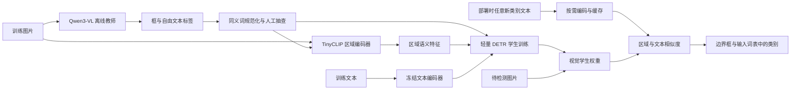

# 面向 Qwen3-VL 的轻量开放类别目标检测

分析日期：2026-10-16。约束：输出框和类别；RTX 4090；学生架构避开 YOLO；类别不锁定为几十个；在满足效果要求的前提下尽量减少参数。

## 结论与边界

推荐以**轻量 DETR + 区域文本对齐 + 离线教师数据蒸馏**作为主线。先建立现成开放词汇检测器的精度参照，再逐步压缩视觉学生。只把大模型换成更小的语言模型，通常会继续承担逐 token 生成框坐标的成本；针对检测任务移除语言生成器有更大的压缩空间。

“接近 Qwen”必须限定输入分布、类别粒度和指标。一个 3–4M 的视觉学生在特定业务分布上接近教师是值得验证的目标；在所有自然图像、任意长尾类别和细粒度物种/商品上接近 Qwen3-VL，目前不能作出保证。教师也不是检测真值，应分别测量其框召回和分类准确性。

开放词汇需要保留共享语义空间。把所有教师名称变成训练分类 ID，然后训练一个固定线性分类头，类别再多也仍是闭集检测。另一方面，接受任意字符串也不自动带来零样本能力，区域表示必须在大量多样的图文数据上学到对齐。

## 当前可行路线比较

| 路线 | 对开放词汇的支持 | 压缩潜力 | 适用判断 |
|---|---|---|---|
| Qwen3-VL 小版本 + 量化/LoRA | 保留语言命名和视觉理解能力 | 量化减少存储/显存，LoRA 减少训练参数；两者不会让原网络的总参数数量大幅减少 | 如果必须完全无提示地自动命名、理解复杂描述，可作为教师或兜底；不是极小检测器的首选 |
| 现成开放词汇 Transformer 检测器 | 已经过区域文本对齐，支持新名称查询 | 从较小视觉骨干、蒸馏和文本缓存逐步压缩 | 最适合先确定“在本业务上能做到什么效果” |
| 轻量 DETR + 文本原型分类 | 推理词表可替换，参数量不依赖类别数 | 视觉路径可探索到约 3–10M；更小的设置需验证容量和定位代价 | 与本任务最契合，但完整开放词汇预训练是主要投入 |
| 候选框 + 轻量 CLIP 区域匹配 | 区域可与任意文本比较 | 可复用小型 CLIP；两阶段会额外运行区域图像编码器 | 快速 demo 和数据诊断有用，框召回、背景误报、裁剪耗时是瓶颈 |
| 固定分类头 + 教师伪标签 | 只能输出训练过的 ID | 容易做得很小 | 不满足本次开放词汇约束，因此不作为交付学生 |

OVLW-DETR 展示了以文本嵌入替换固定分类层、用视觉语言知识对齐轻量 DETR 的路线，这是本 demo 语义分类头的主要参考；本项目没有复现其训练结果。[论文](https://arxiv.org/abs/2407.10655)

2026 年的 OV-DEIM 进一步探索了 DETR 开放词汇检测和语义/定位噪声处理。建议把它作为现成方案的候选，对官方权重在自有数据上的表现先做测量；本项目没有验证其权重，也不把论文报告的 AP 或设备速度直接换算成 4090 结果。[论文](https://arxiv.org/abs/2603.07022)、[官方实现](https://github.com/wleilei/OV-DEIM)

YOLOE/YOLO-World 也提供开放词汇路线，但因你的架构约束，本项目没有选择它们。[YOLOE 官方实现](https://github.com/THU-MIG/yoloe)

## 推荐架构



本项目视觉学生从 D-FINE Nano 初始化。它是 HGNetv2 卷积骨干与 Transformer 混合编码/查询解码结构，官方 Nano 模型量级约 4M；这是定位容量的起点，并不表示原始模型已经开放词汇。[D-FINE 官方实现](https://github.com/Peterande/D-FINE)

学生删除所有固定类别线性输出头和类别 ID 去噪嵌入，编码器候选选择和各层解码器共享同一个语义投影。对区域查询特征 `q` 和文本特征 `t_c`，计算：

```text
z = normalize(W q)
logit(c) = clamp(exp(log_scale), max=100) × dot(z, normalize(t_c)) + bias
```

运行时可以换成任意数量的候选名称，不需增加或重训一个分类权重矩阵。语义空间仍然有限；输入一个新词不保证其意义能被正确识别。

文本编码器采用 TinyCLIP 以便示例体积可控。TinyCLIP 本身使用图文蒸馏训练；本 demo 使用其公开权重，没有复现这项预训练。[TinyCLIP 官方实现](https://github.com/wkcn/TinyCLIP)

## 为什么采用多种训练信号

Qwen3-VL 产生的是名称与框坐标序列，学生产生的是一组查询框与分类分数。两者的 token 分布、查询顺序和输出空间不同，不能把 Qwen 的语言 token logits 直接当成 DETR 各类别 logits 做普通 KL。

本 demo 用 Qwen 的结果监督学生的“找什么、在哪里”，再用预训练图文编码器为区域提供共享语义空间。训练损失为：

```text
L = L_DFINE(boxes, classes, localization distributions, auxiliary decoder layers)
    + 2 × mean(1 - cosine(student matched region, frozen crop embedding))
    + 1 × T² × KL(crop-to-text probabilities || student-to-text probabilities)
```

区域采用一对一 Hungarian 匹配，避免把第 1 个教师框机械对应第 1 个学生查询。辅助区域编码器只参与离线特征生成；推理的视觉路径不需要它。纯文本原型仍需按需计算。

这是一套实现原型，不等于成熟开放词汇预训练配方。训练标签覆盖不足时会产生强烈的 base 类偏置；过窄的教师词表还会把未提及的物体作为背景压制。

## 数据投入比继续缩模型更关键

1. **先测教师。** 用独立人工标注的代表性样本测 Qwen3-VL 的漏检、错框和名称粒度，确认教师是否适合用作定位来源。Qwen3-VL 官方提供 grounding 能力和示例，但本业务仍需测量。[官方说明](https://github.com/QwenLM/Qwen3-VL)
2. **建立多样的区域文本对。** 自由发现类别和大型词表分块查询相结合，采样长尾物体、遮挡、小目标、背景和不含查询类别的图片。图像局部裁剪/高分辨率复查可提升标注质量，但会增加教师成本。
3. **规范同义词而保留描述。** 对 `bike/bicycle` 统一评测名称，对颜色、形状、材质等修饰词保留可追溯映射。不要把不同物种、不同工具粗暴合并成同一父类。
4. **人工抽检与混合监督。** 按类别和大小分层检查伪标签；用少量可靠人工框修正系统性错误。不要将 Qwen 自报的“置信度”视为校准概率。
5. **严格分开训练、验证和测试。** 按拍摄场景/视频来源划分，再按语义类别划 base/novel；近义词、同一物种别名和视频近重复帧会造成伪零样本结果。

数据量不能仅靠类别数估算。可先用一小批覆盖主要场景的人工验证数据定位瓶颈，再逐步扩充到多样的数万级区域样本；若要求极广泛的未见概念泛化，通常需要借助已有开放词汇预训练，而不是只标注少量业务图片。

## 如何继续减小参数

优先顺序是：Nano 真实基准 → 语义蒸馏有效性对照 → Micro → 结构化剪枝/更小骨干 → QAT/低精度部署。

| 改动 | 总参数数目 | 其他主要影响 |
|---|---|---|
| 缩小骨干通道/解码层/投影宽度 | 减少 | 可能损害小目标与长尾类别；需重新训练对齐 |
| 去掉语言生成器，使用文本原型 | 大幅改变模型规模 | 保留检测能力，失去自由命名与复杂语言推理 |
| 文本编码结果缓存 | 不改变编码器固有参数量 | 减少每帧计算和 GPU 驻留；新词仍需编码器 |
| INT8/FP16 | 不减少参数个数 | 减少每个权重的字节数，速度依赖具体算子和硬件 |
| LoRA | 减少需更新的参数 | 不减少部署模型的完整基础权重 |
| 减少查询数/输入分辨率 | 主要降低计算量 | 参数基本不变；可能损害密集实例/小目标召回 |

Micro 原型约 2.82M 视觉参数，但缺少专门预训练。不能因数字更小就认定它优于 Nano。若精度不满足，应先定位框召回还是语义分离瓶颈，再考虑回到 5–15M 的学生。

## 什么结果才算“接近”

建议把验收指标写成明确阈值，而不是“看起来框差不多”。例如先协商以下**目标示例**，它们并非已经实现的结果：

- 相同人工测试集、相同类别查询下，学生 F1 与教师相差不超过 3 个百分点。
- novel 类宏平均召回不低于教师的 90%，并报告各类别样本数，避免高频类别掩盖长尾退化。
- 学生 AP50:95 与自身训练前基线相比提升，同时监控 base/novel 差距；教师无可靠分数时不强行比较 AP。
- 报告单张 4090 的 batch=1、固定输入大小、预热后的 p50/p95 延迟和峰值显存；文本编码与图像推理分开计时。
- 同时报告视觉路径、文本路径和系统总参数，而不是只展示最小的一个数。

如果你要求完全不提供类别提示、自动输出任意新物体名称，需要增加图像标注/类别发现模块，或保留一个小型生成式视觉语言模型。单纯文本相似度检测器只能在传入的候选文本中选择结果；大型可更新词库能扩大自动识别范围，但仍有词库边界。这个区别会决定最终模型体积与能力上限。
